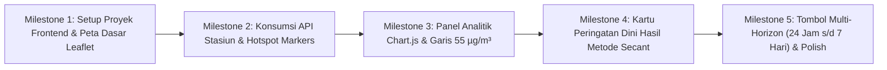

# 🤖 AGENTS.md - Panduan Integrasi UI/UX & Roadmap Frontend

Dokumen ini ditujukan bagi **Pengembang Frontend / Desainer UI/UX (Rekan Tim)** dan agen AI yang bertugas membangun antarmuka Web GIS. Dokumen ini mendefinisikan kontrak data API, fitur multi-horizon (hingga seminggu ke depan), spesifikasi visual, dan roadmap pengembangan frontend.

---

## 🧭 Roadmap Pengembangan Frontend UI/UX



### Milestone 1: Setup Proyek Frontend (Estimasi: 1-2 Hari)
* Pilihan teknologi frontend bebas: HTML5/Tailwind murni, atau React/Next.js/Vue/Vite.
* Inisialisasi peta interaktif menggunakan **Leaflet.js** (Tile: CartoDB Dark/Positron ala IQAir).
* Pusatkan peta di koordinat Indonesia (`lat: -2.5, lon: 118.0`, zoom level: 5).

### Milestone 2: Marker Stasiun & Sebaran Titik Api (Estimasi: 2 Hari)
* Panggil `GET http://localhost:5000/api/stations` saat aplikasi dimuat.
* Buat marker lingkaran (*CircleMarker*) pada setiap stasiun.
* Tampilkan popup detail akurasi model dan nama stasiun.
* Panggil `GET http://localhost:5000/api/hotspots/<city_key>` untuk menampilkan titik api NASA FIRMS dengan ikon api.

### Milestone 3: Visualisasi Grafik Deret Waktu Chart.js (Estimasi: 2 Hari)
* Ketika user mengklik salah satu stasiun di peta, panggil `GET http://localhost:5000/api/predict/<city_key>?days=1`.
* Tampilkan grafik dengan **3 layer garis**:
  1. **Titik Diskrit Prediksi (Garis Teal):** Menggunakan `raw_predictions`.
  2. **Kurva Kontinu Polinomial MA24 (Garis Mulus Cyan):** Menggunakan `polynomial_curve.points_x` dan `points_y`.
  3. **Garis Ambang Batas Nasional (Garis Putus-putus Merah):** Nilai statis `55.0` µg/m³.

### Milestone 4: Kartu Analisis Metode Secant & Early Warning (Estimasi: 1 Hari)
* Baca objek `secant_analysis`:
  * Jika `status == "THRESHOLD_EXCEEDED"`: Tampilkan badge merah dengan pesan:  
    ⚠️ *"Peringatan: Polusi diprediksi melampaui baku mutu 55 µg/m³ dalam **{crossing_hour}** jam ke depan!"*
  * Jika `status == "SAFE"`: Tampilkan badge hijau:  
    ✅ *"Kualitas udara diprediksi aman di bawah baku mutu nasional selama periode peramalan."*
  * Tampilkan informasi matematis: Jumlah iterasi Secant (`iterations`) dan residual error (`residual`).

### Milestone 5: Fitur Multi-Horizon (24 Jam, 3 Hari, 7 Hari) & Deployment (Estimasi: 1-2 Hari)
* Tambahkan tombol filter horizon peramalan:
  - **24 Jam** (`?days=1`)
  - **3 Hari** (`?days=3`)
  - **7 Hari / Seminggu** (`?days=7`)
* Deploy frontend ke Vercel/Netlify atau letakkan langsung di `server/templates/index.html` Flask.

---

## 📡 Kontrak Spesifikasi REST API (API Contract)

Base URL: `http://localhost:5000` (atau URL server produksi Render)

### 1. `GET /api/stations`
Mengembalikan daftar seluruh 6 stasiun pemantau yang aktif beserta metrik akurasinya.

**Contoh Response:**
```json
{
  "total": 6,
  "stations": [
    {
      "key": "medan",
      "name": "Medan (USU)",
      "city": "Medan",
      "province": "Sumatera Utara",
      "region_group": "Sumatera",
      "coordinates": {
        "latitude": 3.539102,
        "longitude": 98.615361
      },
      "hotspot_radius_km": 100.0,
      "metrics": {
        "mae": 6.36,
        "rmse": 11.03,
        "mape_percent": 21.24,
        "accuracy_percent": 78.76
      }
    }
  ]
}
```

---

### 2. `GET /api/predict/<city_key>`
Mengembalikan hasil inferensi Random Forest multi-step, interpolasi kurva polinomial, dan hasil akar Metode Secant.

**Parameter URL:**
* `city_key`: `medan` | `jakarta` | `palembang` | `depok` | `malang` | `bali_ubud`
* **Query Parameter Opsional:**
  * `?days=1` (Default: 24 jam)
  * `?days=3` (72 jam)
  * `?days=7` (168 jam / seminggu ke depan)

**Contoh Response (`GET /api/predict/medan?days=1`):**
```json
{
  "station": {
    "key": "medan",
    "name": "Medan (USU)",
    "city": "Medan",
    "coordinates": {
      "latitude": 3.539102,
      "longitude": 98.615361
    }
  },
  "forecast_horizon": {
    "days": 1.0,
    "hours": 24,
    "start_time": "2026-11-20 12:00",
    "end_time": "2026-11-21 11:00"
  },
  "air_quality_threshold": 55.0,
  "forecast_hours": [
    "2026-11-20 12:00",
    "2026-11-20 13:00"
  ],
  "raw_predictions": [24.5, 26.1, 28.3],
  "ma24_discrete": [22.1, 23.0, 24.2],
  "polynomial_curve": {
    "degree": 3,
    "coefficients": [0.0012, -0.054, 0.85, 21.3],
    "points_x": [1.0, 1.39, 1.78],
    "points_y": [22.12, 22.45, 22.80]
  },
  "secant_analysis": {
    "status": "SAFE",
    "crossing_hour": null,
    "iterations": 0,
    "message": "Kualitas udara diprediksi aman di bawah baku mutu (55 µg/m³) selama 24 jam ke depan."
  },
  "generated_at": "2026-11-20T11:00:00.123456"
}
```

---

### 3. `GET /api/hotspots/<city_key>`
Mengembalikan sebaran titik api satelit NASA FIRMS pada radius pemantauan stasiun kota.

**Contoh Response:**
```json
{
  "city": "medan",
  "station_name": "Medan (USU)",
  "total": 50,
  "hotspots": [
    {
      "latitude": 3.1205,
      "longitude": 98.4512,
      "brightness": 328.4,
      "confidence": "nominal",
      "timestamp": "2025-08-14 13:20:00"
    }
  ]
}
```

---

## 🎨 Panduan Gaya Desain Visual (UI/UX Guidelines)

1. **Skema Warna Rekomendasi:**
   * Latar Belakang: Dark Mode (`#0F172A` / `#020617`).
   * Primary Accent: Teal (`#0D9488` / `#2DD4BF`) & Cyan (`#38BDF8`).
   * Garis Ambang Batas (55 µg/m³): Coral Red (`#EF4444`).
   * Titik Api Hotspot: Flame Orange (`#F97316`).
2. **Kategori Kualitas Udara (Indikator Warna Indeks):**
   * $0 - 15.5\ \mu g/m^3$ : 🟢 **Baik / Baik Sekali** (`#10B981`)
   * $15.6 - 55.0\ \mu g/m^3$ : 🟡 **Sedang / Moderat** (`#F59E0B`)
   * $> 55.0\ \mu g/m^3$ : 🔴 **Tidak Sehat (Baku Mutu Terlampaui)** (`#EF4444`)
3. **Live Reference Code:**
   * Rekan tim dapat melihat contoh implementasi lengkap Leaflet + Chart.js di file `server/templates/index.html`.
